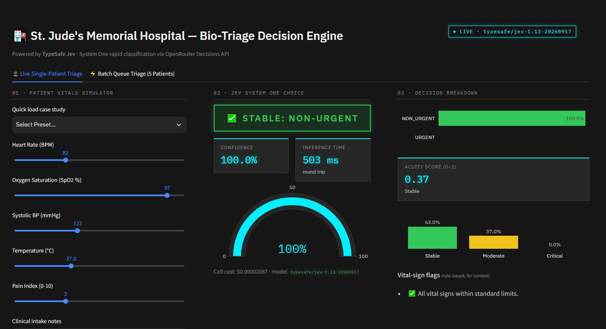

# St. Jude's Bio-Triage Command

An interactive emergency-department triage demo showing **[TypeSafe Jev](https://openrouter.ai/typesafe)** — a "System One" structured decision model — making fast, typed clinical decisions through the **OpenRouter Decisions API**.

Move the vital-sign sliders and Jev re-triages the patient live in about half a second, returning an `URGENT` / `NON_URGENT` choice with calibrated probabilities and a 0–2 acuity score. A batch tab triages a five-patient waiting room in parallel and sorts it into priority order.

> ⚠️ **Demonstration only.** This is not a medical device and must not be used for clinical decisions.



---

## Features

**👤 Live Single-Patient Triage**
- Sliders for heart rate, SpO2, systolic BP, temperature and pain, plus free-text intake notes.
- Three one-click case studies: *Chest Pain & Hypoxia*, *Mild Skin Rash*, *High Fever & Lethargy*.
- Pulsing red **URGENT** / green **NON-URGENT** badge, confidence gauge and round-trip inference time.
- Probability breakdown for both urgency classes.
- **Acuity score** (0 = Stable, 1 = Moderate, 2 = Critical) with its probability distribution.
- Rule-based vital-sign flags for context (clearly labelled — Jev returns decisions, not explanations).
- Per-call cost display (typically ~$0.00002).
- Per-session cache: returning to a vitals state you've already evaluated is instant and free.

**⚡ Batch Queue Triage**
- Evaluates 5 waiting-room patients **concurrently** (thread pool), showing wall-clock time versus the sequential sum.
- Priority-sorted table (urgent first, then by acuity), total batch cost, and per-patient diagnostic expanders.

**Resilience**
- A `● LIVE · typesafe/jev-1.13-…` indicator in the top-right corner shows whether results are real.
- On any API failure (no key, 401, 402 insufficient credits, 429, timeout) the app falls back to a local heuristic, switches the indicator to yellow `● SIMULATED`, and shows the reason.
- One automatic retry on network errors/timeouts.

---

## Quick start

**Prerequisites:** [uv](https://docs.astral.sh/uv/) and Python 3.12+. An [OpenRouter](https://openrouter.ai) API key with a small credit balance is optional — without one the app runs in simulated mode.

```bash
git clone https://github.com/timroman234/jev-st-jude-bio-triage.git
cd jev-st-jude-bio-triage
uv sync

cp .env.example .env        # then paste your key into .env
uv run streamlit run app.py
```

Open http://localhost:8501.

`.env`:

```env
OPENROUTER_API_KEY=sk-or-v1-...
```

The key is read from `.env` at startup (there is no in-app key field). `.env` is gitignored.

---

## How it works

```text
 Streamlit UI (app.py)
   │  vitals + intake notes  →  {"vitals": {...}, "intake_summary": "..."}
   ▼
 jev_client.query_jev()
   │  POST https://openrouter.ai/api/alpha/decisions
   │  model: typesafe/jev-1.13
   │  questions: urgency (choice) + acuity_score (score)
   ▼
 Typed answers ──► badge · gauge · probability bars · acuity · cost
   │
   └── on failure ──► fallback_decision() (local rules, same result shape)
```

### The Jev request

```json
{
  "model": "typesafe/jev-1.13",
  "state": {
    "vitals": {"hr": 128, "spo2": 88, "systolic_bp": 175, "temp_c": 38.2, "pain_level": 9},
    "intake_summary": "58yo male experiencing severe retrosternal pressure..."
  },
  "questions": {
    "urgency": {
      "type": "choice",
      "instructions": "Classify if patient requires immediate critical intervention or standard care.",
      "criteria": {
        "URGENT": "Life-threatening vitals (SpO2 < 92, HR > 120, severe pain, sepsis symptoms, stroke symptoms)",
        "NON_URGENT": "Stable vitals, minor aches, mild rashes, routine symptom checks"
      }
    },
    "acuity_score": {
      "type": "score",
      "instructions": "Grade the clinical severity level on a rubric.",
      "criteria": [
        "Stable: vitals within normal physiological boundaries",
        "Moderate: single abnormality or moderate discomfort",
        "Critical: multi-organ risk, severe respiratory distress, or hemodynamic instability"
      ]
    }
  }
}
```

### The Jev response (abridged)

```json
{
  "model": "typesafe/jev-1.13-20260917",
  "answers": {
    "urgency": {
      "type": "choice", "choice": "URGENT", "confidence": 1,
      "probabilities": {"URGENT": 1, "NON_URGENT": 0}
    },
    "acuity_score": {
      "type": "score", "score": 2, "confidence": 1,
      "probabilities": {"0": 0, "1": 0, "2": 1},
      "legend": {"0": "Stable: ...", "1": "Moderate: ...", "2": "Critical: ..."}
    }
  },
  "usage": {"input_tokens": 521, "output_tokens": 53, "cost": 0.000021882}
}
```

Notes on the API:
- `choice` criteria are a **dict** of `{label: description}`; `score` criteria are an **ordered list** (index = score).
- The response has no timing field — latency shown in the UI is measured client-side.
- Full reference: [OpenRouter Decisions API](https://openrouter.ai/docs/api/api-reference/alphadecisions/submit-a-decisions-questions-and-answers-request) · [Jev guide](https://openrouter.ai/docs/guides/community/jev).

---

## Project structure

```text
.
├── app.py                  # Streamlit UI: header, single-patient tab, batch tab
├── jev_client.py           # Jev API client, fallback heuristic, vital-sign flags (no Streamlit imports)
├── data.py                 # Preset case studies and batch waiting-room patients
├── styles.py               # IBM Carbon (Gray 100 dark) CSS + neon triage accents
├── .streamlit/config.toml  # Streamlit dark theme
├── .env.example            # Template for OPENROUTER_API_KEY
├── docs/                   # README screenshots
├── jev_prd.md              # Original product requirements document
└── pyproject.toml          # uv project / dependencies
```

## Tech stack

- **[Streamlit](https://streamlit.io)** — UI
- **[Plotly](https://plotly.com/python/)** — gauge and bar charts
- **[TypeSafe Jev](https://openrouter.ai/typesafe/jev-1.13)** via **[OpenRouter](https://openrouter.ai)** — decisions
- **IBM Carbon Design** (dark) with neon accents — styling
- **requests**, **pandas**, **python-dotenv**

## Cost

Jev is billed per input token (~$0.042 / million); output is free. One triage call is ~520 input tokens ≈ **$0.00002**, so a full 5-patient batch costs about $0.0001.

## Troubleshooting

| Indicator shows | Meaning / fix |
|---|---|
| `SIMULATED` · *No API key provided* | Add `OPENROUTER_API_KEY` to `.env` and restart. |
| `SIMULATED` · *HTTP 401* | Key is invalid — regenerate it at openrouter.ai/keys. |
| `SIMULATED` · *HTTP 402* | Add credits to your OpenRouter account. |
| `SIMULATED` · *HTTP 429* | Rate-limited; wait a moment and change a slider. |
| `SIMULATED` · *Network error* | Check connectivity; the client already retried once. |

## Disclaimer

All patients are fictional. Triage outputs are illustrative and are not medical advice.
